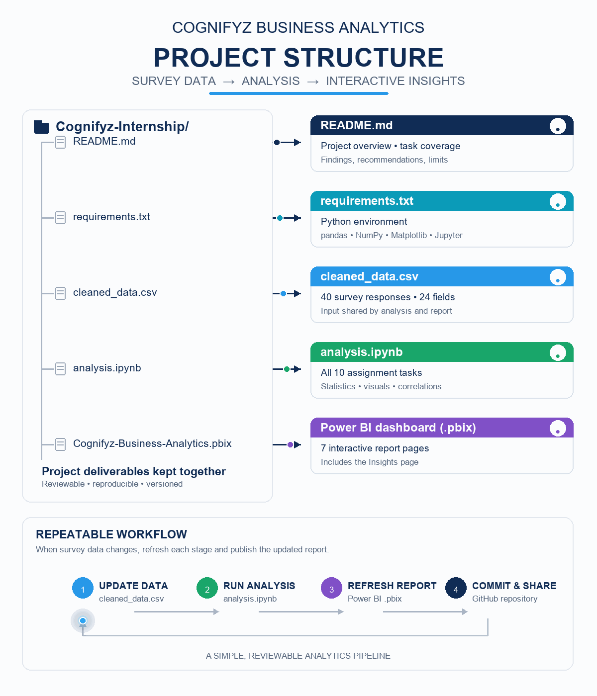

# Cognifyz Business Analytics Internship Project

An exploratory analysis and Power BI report based on the Cognifyz investor survey dataset.

## Deliverables

- `Cognifyz-Business-Analytics.pbix` — interactive Power BI report with seven pages, including an Insights page.
- `analysis.ipynb` — executed analysis notebook covering all ten assignment tasks, with findings, interpretation, recommendations, and limitations.
- `cleaned_data.csv` — 40 survey responses and 24 fields used by the notebook and report.

## Analysis covered

1. Data overview and quality checks
2. Gender distribution
3. Descriptive statistics
4. Preferred investment avenue
5. Reasons for investment
6. Savings objectives
7. Investment information sources
8. Investment duration
9. Return expectations
10. Correlation analysis

## Key sample findings

- Mutual funds are the most selected avenue: 18 of 40 respondents (45%).
- Retirement planning is the leading savings objective: 24 of 40 (60%).
- 32 respondents (80%) expect returns in the 20%–30% band. This is a reported expectation, not a forecast or guarantee.
- Age has near-zero linear correlations with approximate duration (r = 0.05) and expected-return midpoint (r = -0.09) in this sample.

## Open the analysis

Open `analysis.ipynb` in Jupyter Notebook or JupyterLab. The notebook expects `cleaned_data.csv` in the same directory. Open the `.pbix` file in Microsoft Power BI Desktop to explore the report.

## Limitations

The dataset contains 40 survey responses. Findings describe this sample and should not be treated as representative population estimates. Duration and return correlations use category midpoint approximations. The survey is descriptive and does not establish causation, actual investment performance, or individual suitability.

## Reproducibility

Notebook dependencies: Python 3, pandas, NumPy, and Matplotlib. Outputs are included in the notebook.
